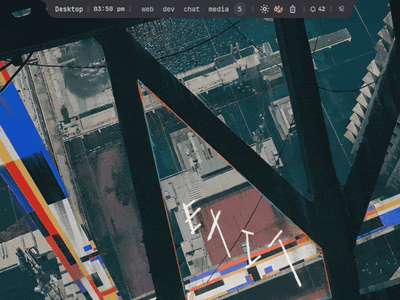
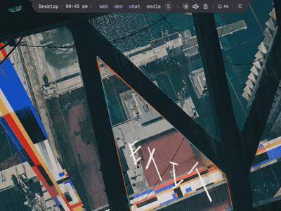
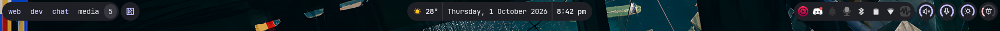
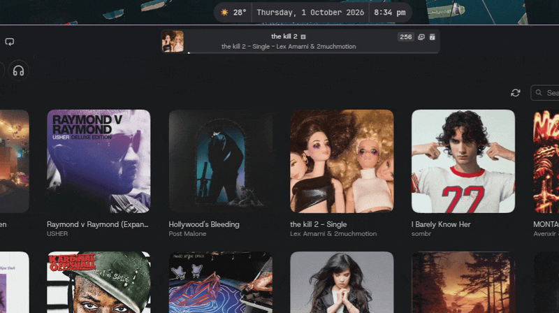
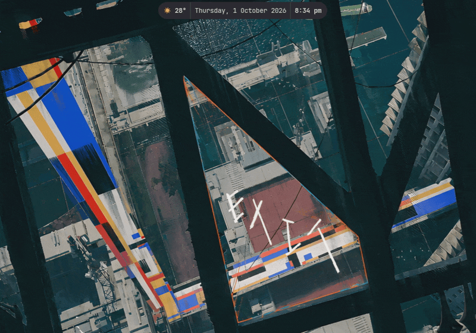
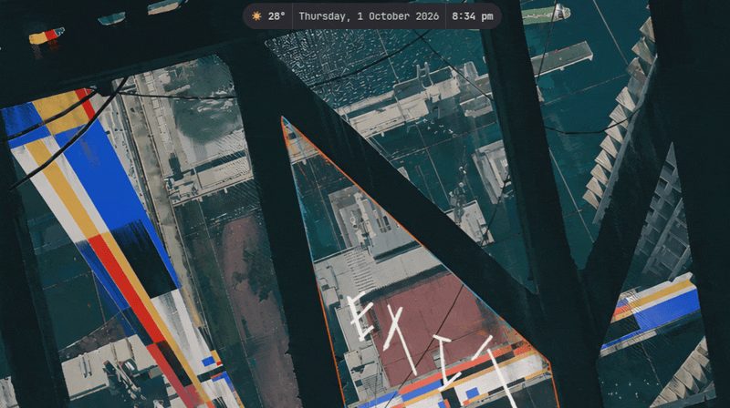
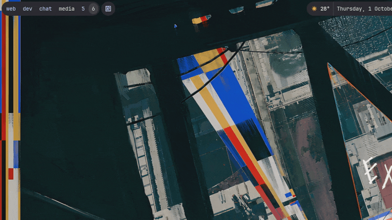
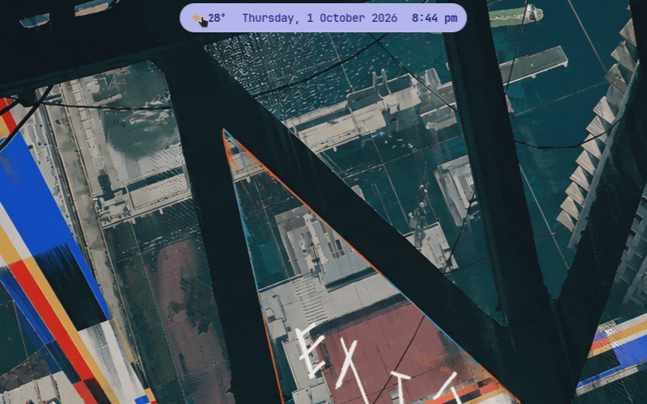
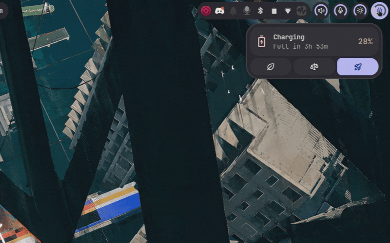

#  Nonchalant Shell

**Nonchalant Shell** supports Niri and Hyprland and is built with
[Quickshell](https://quickshell.org).

## Hard fork

This project is a **hard fork** of
[Ambxst](https://github.com/Axenide/Ambxst) by
[Axenide](https://github.com/Axenide).

It is not Ambxst, does not track Ambxst as an upstream merge target for
day-to-day work, and ships under its own name, branding, config paths, and
release process. The fork keeps a lean runtime focus:

- wallpaper
- one unified bar
- floating run menu
- lockscreen
- searchable settings and synchronized lyrics
- reactive JSON configuration

Multi-monitor support uses Quickshell `Variants` on `Quickshell.screens`.

## Features

- Runs on [Niri](https://github.com/niri-wm/niri) or [Hyprland](https://hypr.land) through a shared typed compositor service
- Normalized monitor, workspace, and window state for multi-monitor setups
- Unified bar with workspaces/taskbar, clock, system status, and systray
- Five bar layouts: Default, Island, Pills, Left, and [Deck](docs/deck-layout.md), a compact strip with window tabs and task-specific flyouts
- Floating run menu and power menu
- Wallpaper picker and secure `WlSessionLock` session lock
- Searchable settings with section history, previews, and the existing configuration domains
- Synchronized lyrics in the media players and lockscreen
- Separate configuration, per-shell state, cache, data, and IPC paths

## Compositor selection and testing

The shell selects Niri or Hyprland from the session socket environment. If both
are present, desktop identity resolves the session. Use
`NONCHALANT_COMPOSITOR=niri` or `NONCHALANT_COMPOSITOR=hyprland` to select explicitly.
Niri needs its `niri` executable; Hyprland uses the Quickshell native module.

The Nix package pins Quickshell 0.3.2 and matching Qt libraries separately from
the existing runtime tools. Test tools and disposable compositor sessions are
available through Nix:

```bash
nix develop path:.#compositor-test --command ./tests/run_tests.sh --all
nix develop path:.#compositor-test --command python3 tests/runtime/run_compositor.py --compositor niri --shell --style island
nix develop path:.#compositor-test --command python3 tests/runtime/run_compositor.py --compositor hyprland --shell --style default
```

These runs use private displays and session paths. They leave your desktop
running. The headless Hyprland test environment contains an Aquamarine nesting
patch; your installed compositor and production shell package are unchanged by
that test-only patch. See [compositor design](docs/compositor-design.md) for behavior differences
and test limits.

## Showcase

### Island bar


<details>
<summary>View previews</summary>

| | |
|---|---|
| **Launcher** — search and launch apps from the island<br> | **Dashboard** — controls, media and quick toggles<br> |
| **Wallpaper picker**<br> | **System monitor**<br> |
| **Sound**<br> | **Wi-Fi**<br> |
| **Calendar**<br> | **Power menu**<br> |
| **Weather**<br> | **Battery & power profile**<br> |

</details>

### Classic bar



<details>
<summary>View previews</summary>

| | |
|---|---|
| **Launcher**<br> | **Dashboard**<br> |
| **Wallpaper picker**<br> | **System monitor**<br> |
| **Power menu**<br> | **Weather**<br> |
| **Battery & power profile**<br> | |

</details>

## Direct commands

The shell exposes lightweight commands through its IPC runner. For example,
`nonchalant run wallpapers` opens the wallpaper picker on the focused monitor
and toggles it closed when invoked again. This can be bound from Niri with:

```kdl
Mod+Shift+W hotkey-overlay-title="Open Wallpapers" { spawn "nonchalant" "run" "wallpapers"; }
```

### Settings and lyrics

Pin the Island or Pills bar from Shell settings, or bind
`qs ipc call nonchalant run bar-pin` to toggle pinning. Pinning keeps the bar
visible and reserves window space. The bar itself has no pin button.

`nonchalant run settings` opens the redesigned settings window. Search settings,
move between sections with back and forward history, and adjust colors with the
built-in color picker. Existing Network, Bluetooth, Mixer, AI, theme, and system
controls use the same configuration store.

Lyrics follow the selected MPRIS player. Timed lines follow playback and can be
clicked to seek; plain lyrics scroll manually. Shell settings provide separate
media-player and lockscreen switches. The collapsed bar keeps showing the track
or focused window title. Media panels collapse the lyrics area until usable
lyrics arrive. Cider playback uses the exact Apple Music recording ID from its
local API and prefers Apple's word timings. Timed words highlight in all media
views, including the lockscreen's current-line-only player. Songs with line or
plain lyrics keep those formats. Long word-timed lines follow the current word
horizontally in compact views.

The Cider integration uses `http://127.0.0.1:10767` and its external playback
and account APIs. Its internal lyrics endpoint is restricted in current Cider
builds, so the helper reads the authorized session through `/api/v2/client/tokens`
and requests the same Apple Music lyrics endpoint as Cider. Credentials stay in
the helper process and are never written to the shell configuration or cache.
If Cider requires an app token, set `CIDER_API_TOKEN_FILE` in the shell's
environment to a private file containing a token with `playback` and `account`
scopes. `CIDER_PORT` selects a custom local port. The integration adds no Python
dependencies and needs no Cider plugin.

For other players, or when Cider's API or lyrics are unavailable, track title,
artist, album, and duration are sent to [LRCLIB](https://lrclib.net). Results are cached
under `$XDG_STATE_HOME/nonchalant/lyrics`. Closed panels do not start new lookups
or retries. Changing tracks or closing the last active lyrics view cancels the
old lookup and discards its output.
Retries are scheduled by the active lyrics service, not by the Python helper.
The lyrics helper requires Python 3.

YouTube playback uses the video title to identify the song instead of treating
its upload channel as the artist. Matching video-length recordings can provide
timed lyrics. When only a different-length recording is available, its lyrics
scroll manually. Videos without an identifiable song or an unambiguous match
can still have no lyrics.
YouTube duration is verified from the selected video's own metadata with
`yt-dlp`, including when a browser omits duration or keeps the previous video's
length. Only the canonical video ID is sent to YouTube. No media is downloaded
and no browser cookies or yt-dlp user configuration are used. Verified durations
are cached for 24 hours in `$XDG_STATE_HOME/nonchalant/media-duration`. Failed
requests retry with backoff; track changes cancel extraction and discard stale
results. Install `yt-dlp` alongside Python 3 for this integration.

Native player durations remain authoritative for other media. A valid duration
is retained for the same track when a later MPRIS update omits it, and cleared
on track or player changes. Live streams have no finite total. Progress and
fractional seeking use the shared duration in every media view.

This repairs duration reporting in the shell. It does not patch Firefox's
separate upstream bug where Position can become zero after seeking.


## Run the development tree

Install Quickshell 0.3.2 and the runtime tools needed by the shell. Install fonts once,
then run from a checkout:

```bash
./scripts/install-fonts.sh
qs -p /path/to/nonchalant-shell
```

Or use the CLI wrapper:

```bash
./cli.sh
```

Run the relevant validation suite with `python3 tests/run_tests.py --all`.
Runtime checks use isolated Quickshell configuration and state.

The installer and Nix package are still inherited scaffolding and may need
adjustment for this fork.

## Attribution and license

Nonchalant Shell is derived from Ambxst by Axenide. Full copyright and
contributor history from that lineage is preserved in this repository’s Git
history.

The settings presentation and lyrics port incorporate
work from [Impasto](https://github.com/andreumassanet/impasto) by Andreu Massanet,
based on revision `6d759aa3fe16e3b40641beeb9b24e3c4afcfeefe`. That upstream is
GPLv3-licensed; its retained source notices and
[license](./docs/licenses/impasto.txt) apply to the incorporated work.

This project is licensed under the GNU Affero General Public License v3.0 or
later. See [LICENSE](./LICENSE).
