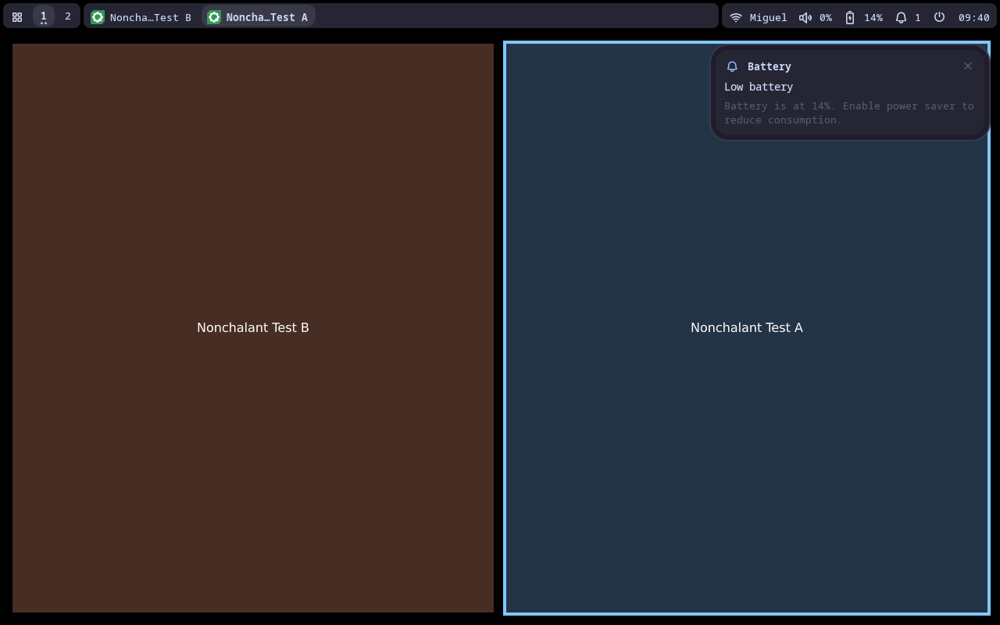
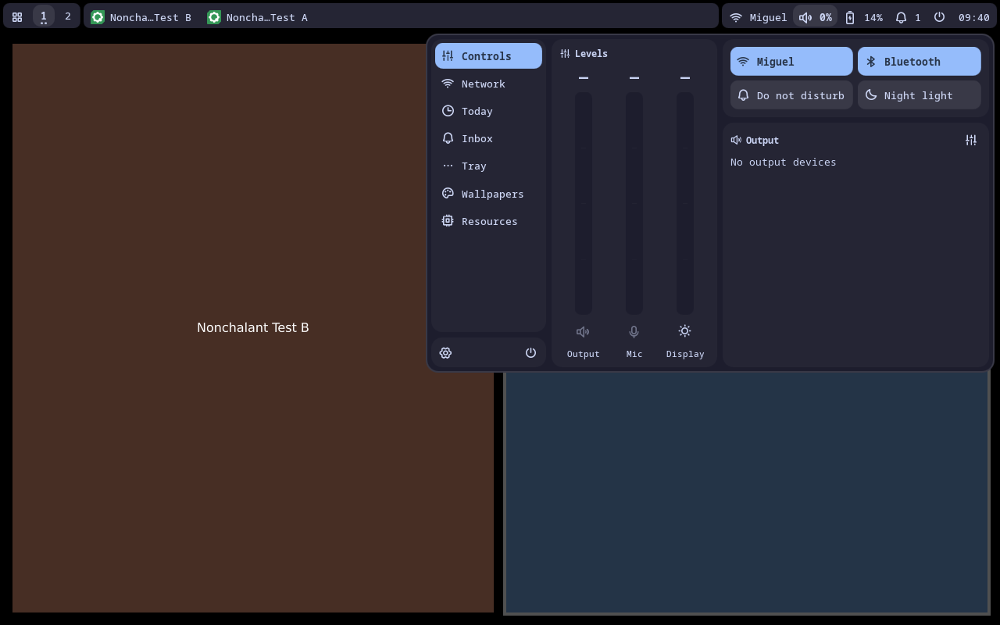
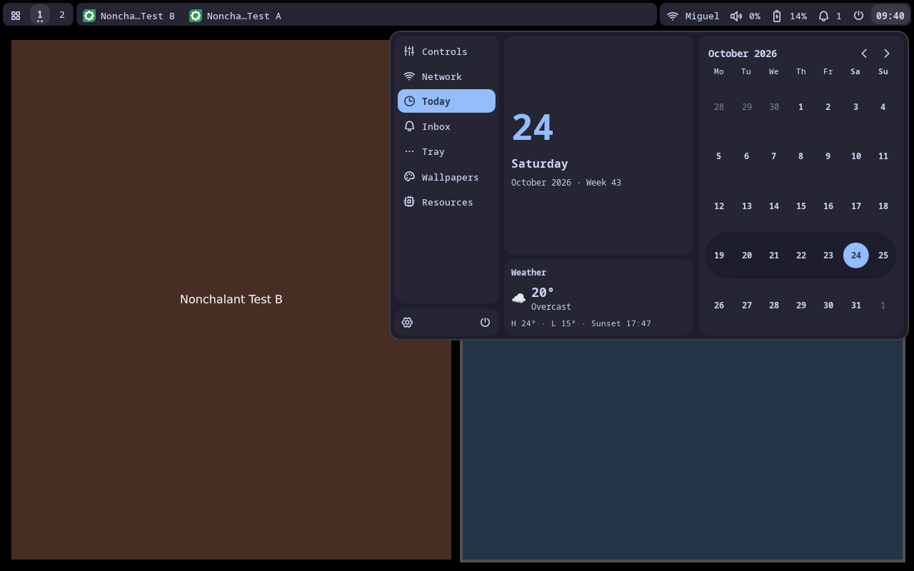
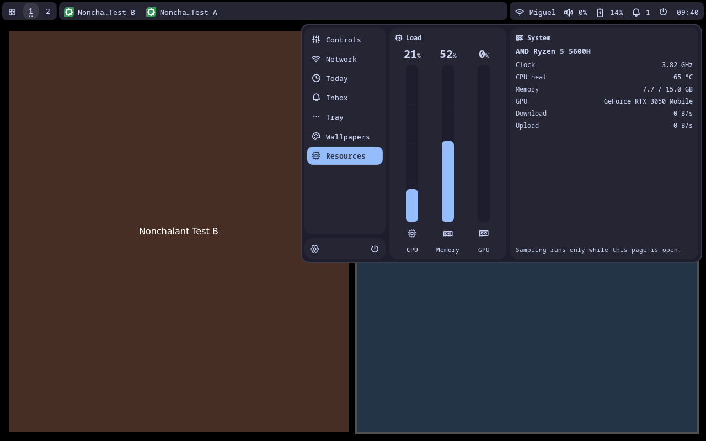
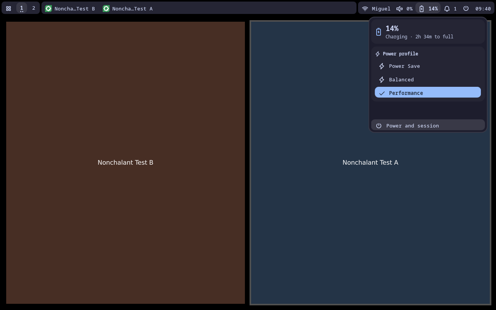
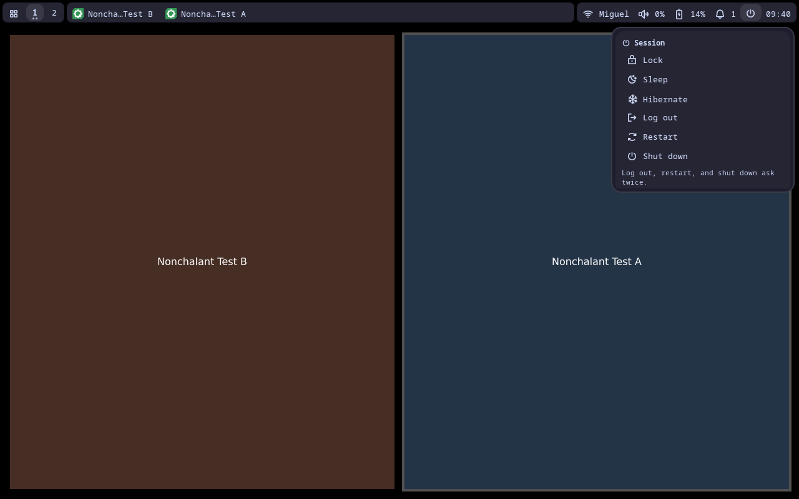
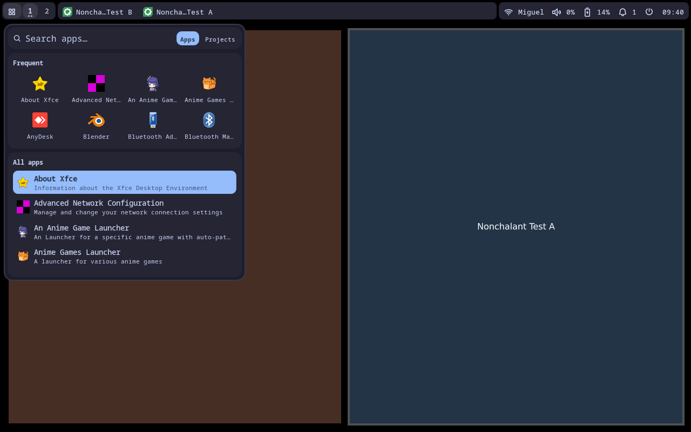

# Deck

Select **Settings → Shell → Bar → Style → Deck**. Position chooses the top or bottom edge.

Deck keeps the compact workspace, window, and status strips. At the default 14px font, the bar is 32px high and reserves at most 40px including gaps.



## The dash

Status buttons open one fixed-size dash at the page they belong to. A page rail on the left switches between Controls, Network, Today, Inbox, Tray, Wallpapers, and Resources. The rail has no counters. Settings and Power sit in their own card at its foot.

Every page is built from separate cards on the dash surface, so each component reads on its own:

| Page | Cards |
| --- | --- |
| Controls | Levels (Output, Mic, and Display faders) · Quick toggles (Wi-Fi, Bluetooth, Do not disturb, Night light) · Now playing, when a player exists · Output devices with a per-app volume shortcut |
| Network | Wi-Fi/Bluetooth toolbar with radio, scan, and settings · Current connection · Available networks or devices |
| Today | Date · Weather · Month |
| Inbox | Header with Do not disturb and Clear all · one card per notification |
| Tray | Header with Back · background apps and menus |
| Wallpapers | Search · thumbnail grid |
| Resources | Load meters · System details |

The dash never scrolls as a whole. Toolbars, current connections, and headers stay fixed. Only lists such as available networks, output devices, notifications, tray menus, and wallpapers scroll inside their own cards.

Quick toggles fill with the primary color when on. Right-click Wi-Fi or Bluetooth to open its Network tab. The month card divides its full height between the displayed weeks. Days from adjacent months are muted, and the current week has a band.







## Bespoke flyouts

Battery and Power are compact flyouts under their triggers, without the rail. Battery shows charge, time remaining, and power profiles. Power lists Lock, Sleep, Hibernate, Log out, Restart, and Shut down. Log out, Restart, and Shut down need a second click within three seconds. Cancel, Escape, closing, or switching pages clears the confirmation.

 

## Launcher

Deck replaces the centered run menu with its own launcher. It unrolls under the bar's launcher button, or above it on bottom bars. Search stays pinned in its own card. With an empty search, a Frequent card shows the eight most-used apps above the All apps list. While you type, the list shows results. Tab switches between Apps and Projects. Up/Down, Page Up/Page Down, and Enter work from the search field, and Escape closes.



## Motion

Deck has its own motion tokens in `modules/bar/deck/DeckMotion.qml`, separate from the island springs in `Motion`:

- **Rail.** The bar, dash, flyouts, and launcher unroll from the bar edge on a fast-decelerating curve (`OutExpo`) and retract quickly with `InQuad`. Content trails the surface edge slightly.
- **Pages.** Switching pages slides the new page along the rail's direction: up when moving to a tab above, down when moving below.
- **Cards.** Cards land in sequence with a short lift and a small detent.
- **Detents.** The rail's selection indicator and the launcher's highlighted row slide into place with a small overshoot.

All durations scale with the theme's animation duration. Setting it to 0 disables Deck motion.

## Interaction

Clicking a trigger for the page already shown closes the dash. Another trigger switches pages in place. Ctrl+Tab and Ctrl+Shift+Tab (or Ctrl+Page Down/Up) walk the rail. Plain arrow keys stay with the focused control. Escape or an outside click closes. Focusing a window, changing workspace, entering fullscreen or overview, hiding the bar, and changing styles release popup ownership.

Workspace buttons switch workspaces, and scrolling them selects an adjacent workspace. Window tabs focus on click and close on middle-click. Right-click opens the compositor's native overview where supported. The volume button supports wheel adjustment and right-click mute.

## IPC routes

Use `qs ipc call nonchalant run <command>`:

| Commands | Result |
| --- | --- |
| `controls`, `sound`, `audio`, `mic`, `microphone`, `media`, `music`, `player`, `dashboard` | Controls page |
| `connections`, `network`, `wifi`, `bluetooth` | Network page and requested tab |
| `today`, `calendar`, `datetime`, `weather` | Today page |
| `alerts`, `notifications` | Inbox page |
| `tray` | Tray page |
| `wallpapers`, `wallpaper` | Wallpapers page |
| `stats`, `resources`, `system-monitor` | Resources page |
| `battery`, `powerprofile` | Battery flyout, or Power when no battery exists |
| `power`, `powermenu` | Power flyout |
| `launcher` | Deck launcher |
| `windows` | Native overview, with an explicit unsupported result on compositors without one |

## Implementation and coverage

`DeckBar` normalizes routes and selects their trigger. `DeckDrawer` is the per-output popup controller: dash pages share its fixed geometry and rail; flyouts size to their content under the trigger. `DeckCard` is the shared card container and runs the card entrance. `RunMenuHost` loads `DeckLauncher` instead of the generic run menu when the bar style is Deck, so the panel's focus, mask, and backdrop handling stay the same.

Run the focused fixture with:

```sh
python3 -m unittest tests.e2e.test_deck_runtime
```

It checks the populated bar at several widths and both edges, dash and flyout geometry for every route, rail switching with stable dash geometry, the rail indicator, Ctrl+Tab navigation, network list scrolling with a pinned toolbar and current connection, password handling, calendar rollover and the final week, faders and notification actions, power confirmation, launcher placement, focus, and mode switching, overview dispatch, and sampling lifetime. Set `DECK_TEST_PYTHON` to a Python environment with `dbus-next` to include real private-bus tray menu dispatch.

Run the complete shell on a disposable compositor with:

```sh
python3 tests/runtime/run_compositor.py --compositor niri --shell --style deck
```

This captures every page, flyout, and the launcher with live clients. All displays, runtime/config/cache paths, and D-Bus sessions are private. Hardware audio/brightness, real Wi-Fi authentication and Bluetooth pairing, mixed-scale monitor hotplug, and actual power/logout actions still need separate acceptance testing. The power tests never execute a shutdown, reboot, logout, suspend, or lock.

The bundled Phosphor font's provenance and license are in `assets/fonts/README.md`.
