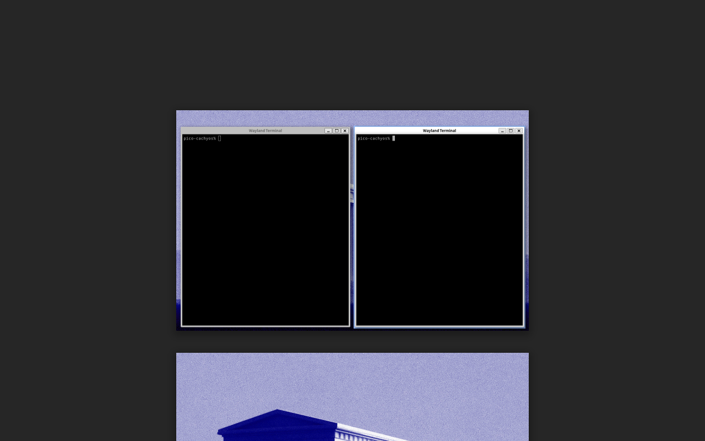
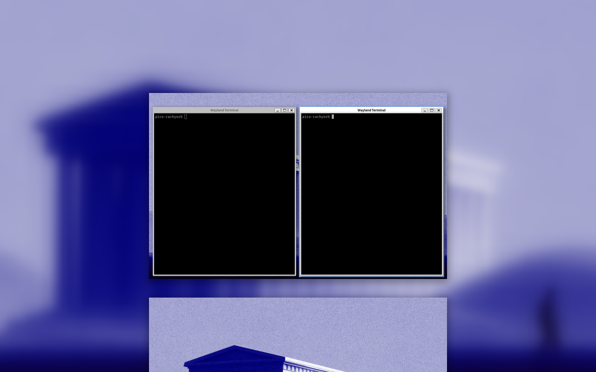
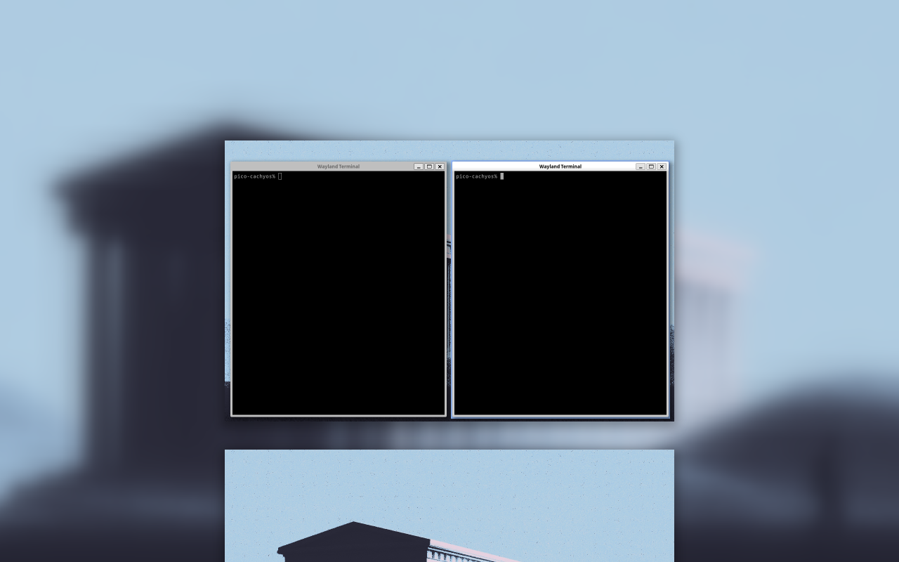
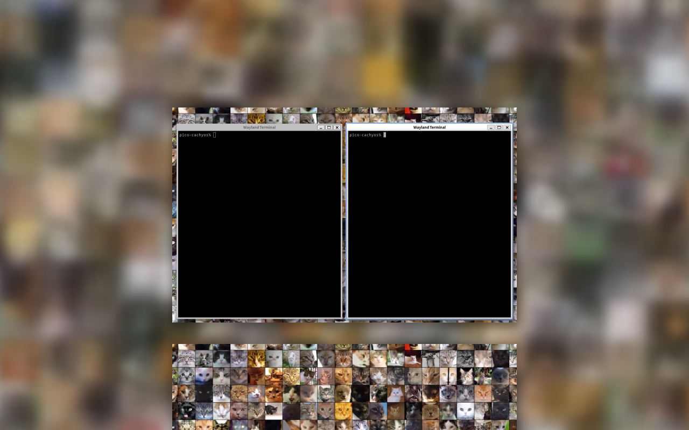
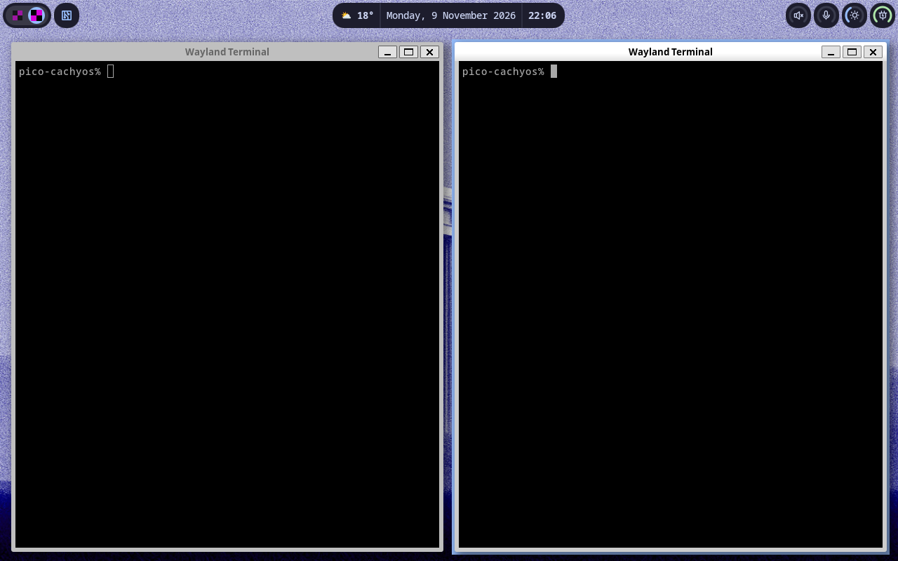
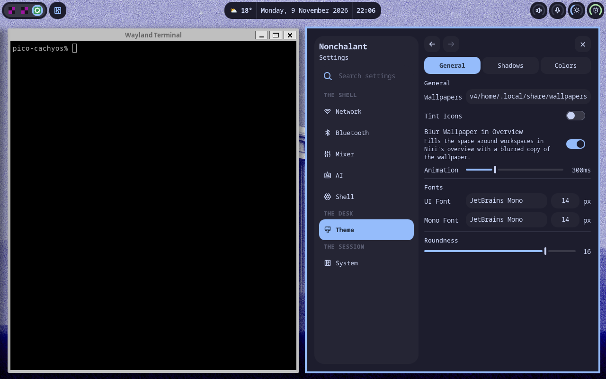

# Overview wallpaper blur

**Settings → Theme → General → Blur Wallpaper in Overview** (`theme.overviewWallpaperBlur`,
default off) fills the space around workspaces in Niri's overview with a
blurred copy of each screen's wallpaper.

## How it works

- `shell.qml` creates an `OverviewBackdrop` per screen, next to that screen's
  `Wallpaper`, only while the setting is on and the session is Niri.
- `OverviewBackdrop` is a background layer surface named
  `nonchalant:overview-backdrop`. It ignores exclusive zones and pointer input.
- `NiriGenerator` writes a layer rule into `~/.cache/nonchalant/niri-colors.kdl`
  that matches that namespace and sets `place-within-backdrop true`. Niri then
  draws the surface only in the overview backdrop. The desktop looks unchanged.
- The blur is a `MultiEffect` rendered once into a cached layer. The surface
  stays idle until the wallpaper or tint changes.
- Hyprland has no overview backdrop, so the toggle is disabled there and no
  surface is created.

Video and GIF wallpapers use the cached still frame that the lockscreen also
uses. The frame is generated asynchronously, so `Wallpaper.getLockscreenFrameUrl()`
appends `GlobalStates.wallpaperFrameRevision` to generated frame URLs. Every
consumer reloads once the frame exists. Before this change, a consumer that
loaded before the frame was written stayed empty.

## Surface ledger

| Surface | Source | Change | Check | State |
| --- | --- | --- | --- | --- |
| Settings toggle | `ThemePanel.qml` | New row. The shared `ToggleRow` also drives Tint Icons | Private Niri screenshot | Passed |
| Settings search | `SettingsIndex.qml` | `overview blur backdrop niri` keywords | Source review | Not exercised |
| Config | `defaults/theme.js`, `Config.qml` | `overviewWallpaperBlur: false` | Live JSON edit hot-reloads the surface | Passed |
| Overview backdrop surface | `OverviewBackdrop.qml`, `shell.qml` | Per-screen surface only while enabled on Niri | `niri msg layers` with the setting off, on, and off again | Passed |
| Niri rule | `NiriGenerator.qml` | `place-within-backdrop` layer rule | Runtime test plus `niri validate` on the generated include | Passed |
| Desktop outside overview | Niri backdrop placement | None | Screenshot with the setting on | Unchanged |
| Static image | `Wallpaper.getLockscreenFrameUrl` | Plain `file://` URL shares the pixmap cache | Overview screenshot | Passed |
| Video/GIF wallpaper | Same | Revisioned frame URL | Switch to video through `setWallpaper`, then overview screenshot | Passed. It failed before the revision fix |
| Wallpaper tint | `TintedWallpaper` | Follows `tintEnabled` | Overview screenshot with tint on | Passed |
| Lockscreen, preloader, island media card and center, full and lock players | Frame URL consumers | Use `getLockscreenFrameUrl` | Source review. Lockscreen and media flows were not exercised | Not tested |
| Hyprland | `shell.qml`, `ThemePanel.qml` | Surface gated off. Toggle disabled | Source review | Not tested |
| Multi-monitor and per-screen wallpapers | `Variants` per screen | Owner is that screen's `Wallpaper` | Source review | Not tested |
| Real GPU cost | `MultiEffect` cached layer | None | Not measured | Not tested |

## Screenshots

Captured with a private headless Niri 26.04 at 1280×720 using llvmpipe.

| Setting off | Setting on |
| --- | --- |
|  |  |

| Tinted wallpaper | Video wallpaper |
| --- | --- |
|  |  |

| Desktop with setting on | Settings |
| --- | --- |
|  |  |
